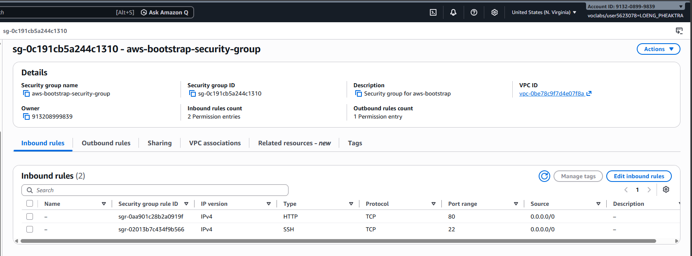
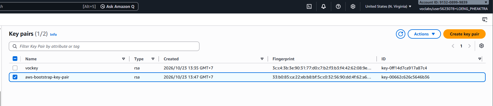
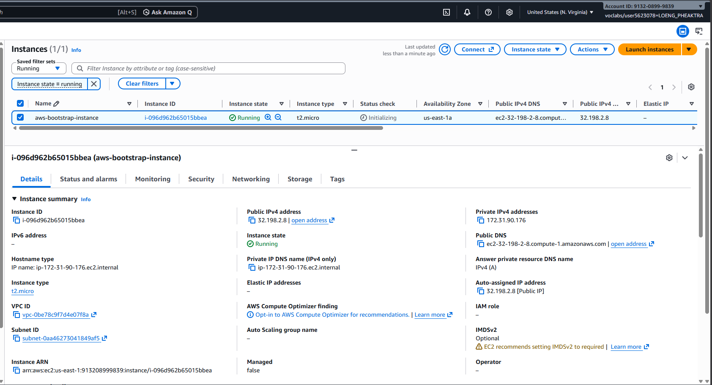
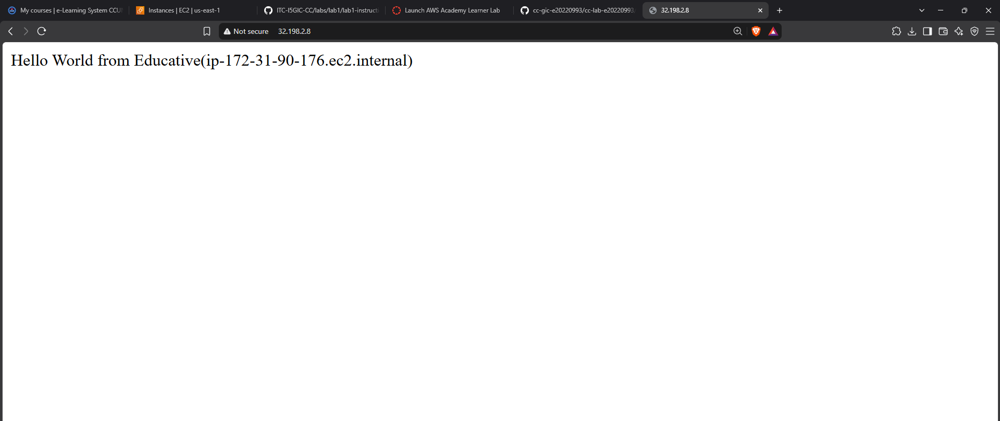
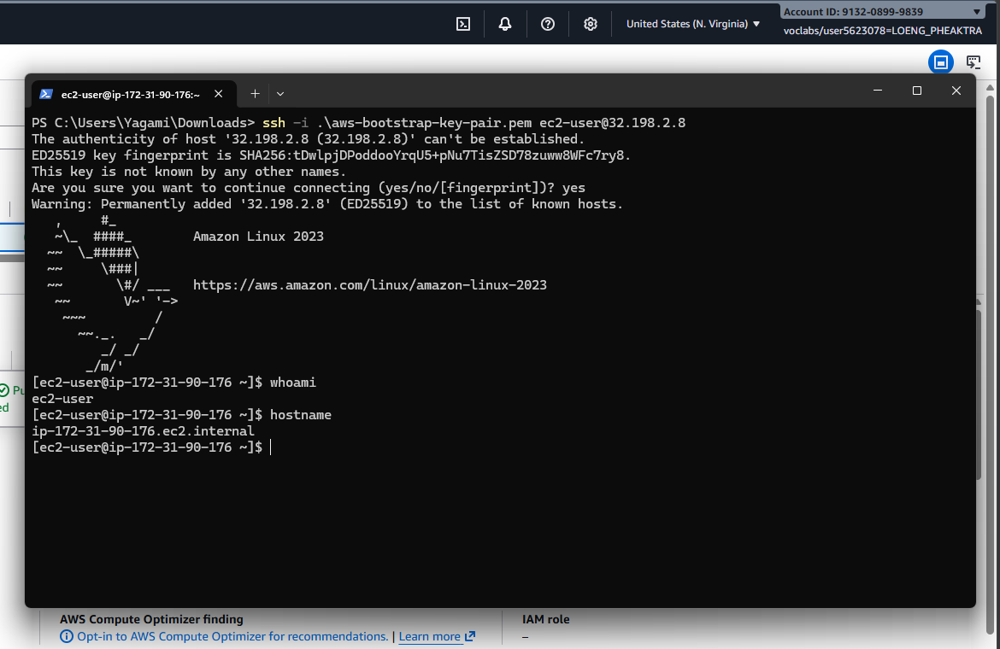
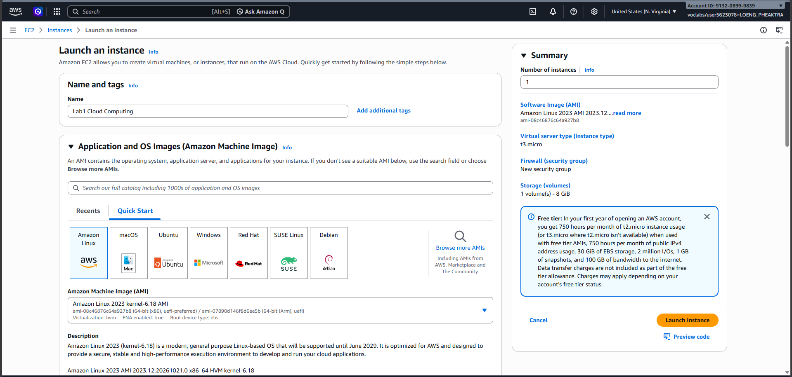
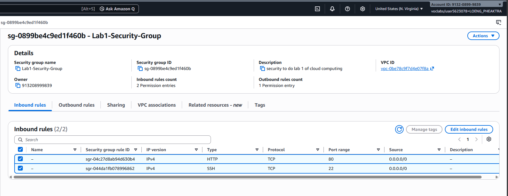
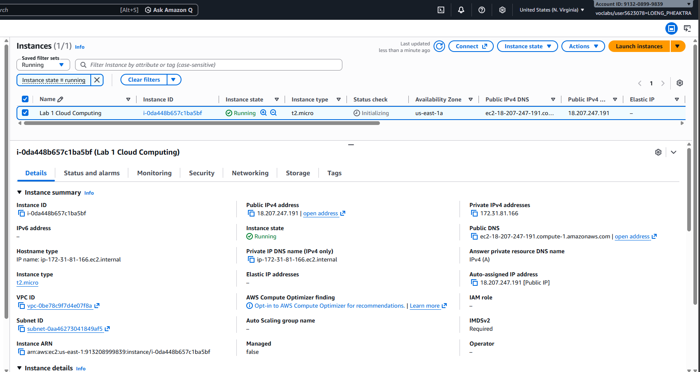
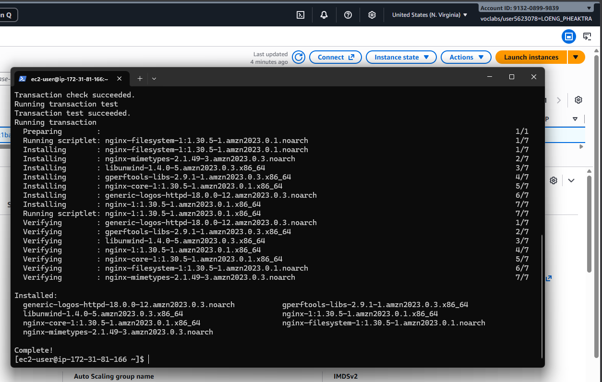
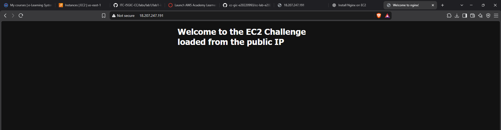

# Cloud Lab 1 Submission — Amazon EC2

- **Student name: Loeng Pheaktra**
- **Student ID:**
- **Learner Lab user name: LOENG_PHEAKTRA**
- **Date completed: 10/23/2026**

---

## Part 1.1 — An Amazon EC2 Walkthrough

### Security group



### Key pair



### Instance details



### Browser test



### SSH connection



Did you connect with your own SSH client or with EC2 Instance Connect?

---

## Part 1.2 — EC2 Web Solution (Challenge)

### Launch configuration



### Security group



### Running instance



### Commands on the instance



Paste the commands you ran to install the web server and create `index.html`:

```bash

```

### Browser test



---

## Questions

1. Your security group has an SSH rule and an HTTP rule. What does each one let you do? What would stop working if you deleted the HTTP rule?
2. In Part 1.1 you never logged in to install the web server. What installed it, and when did it run?
3. Why does the web page open with `http://` but not with `https://`?
4. Part 1.2 asked for a 10 GiB root volume. Where in the launch settings did you set it, and how can you check the size on the running instance?

## Answer

1. SSH rule: Allows remote server access through port 22. HTTP rule: Allows web traffic through port 80. Without HTTP, the website would not be accessible through a browser.

2. The web server was installed by a user data script in the EC2 launch settings. It ran automatically when the instance first started.

3. The website uses http:// because HTTP is configured, but HTTPS requires an SSL/TLS certificate and HTTPS configuration, usually on port 443.

4. I set the root volume size to 10 GiB in the Storage (Configure storage) section during instance launch. I can check it in EC2 → Instances → Storage or run lsblk in the terminal.

## Clean up

- [x] Part 1.1: instance terminated, key pair and security group deleted.
- [x] Part 1.2: instance terminated, security group (and key pair, if any) deleted.
