# Cloud Lab 4 Submission — Amazon VPC

- **Student name: LOENG Pheaktra**
- **Student ID: e20220993**
- **Learner Lab user name: LOENG_PHEAKTRA**
- **Date completed: 06/11/2026**

---

## VPC and internet gateway

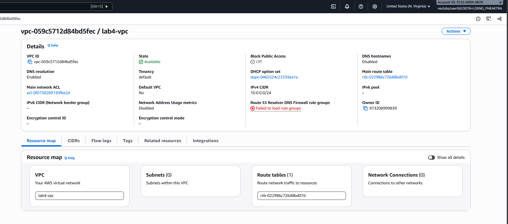

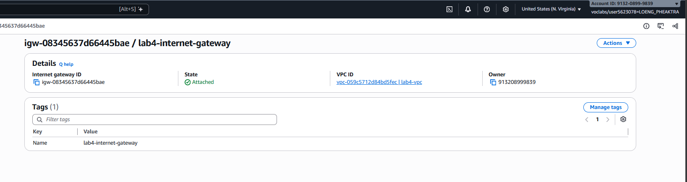

## Public subnet

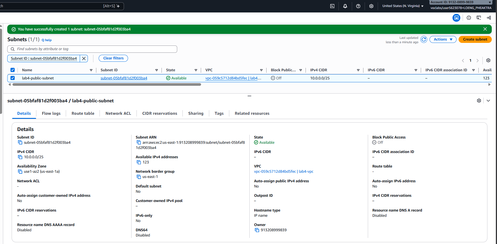

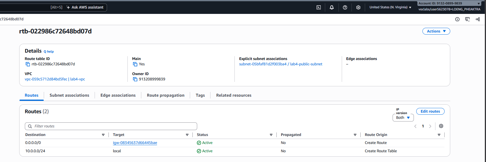

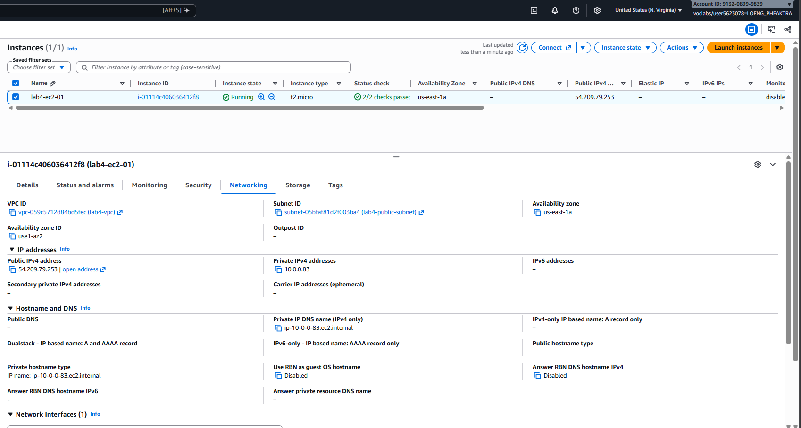

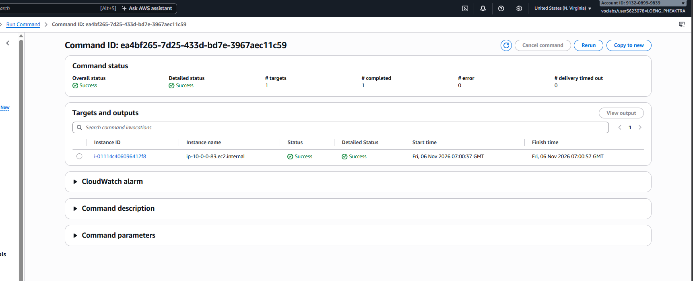

## Private subnet

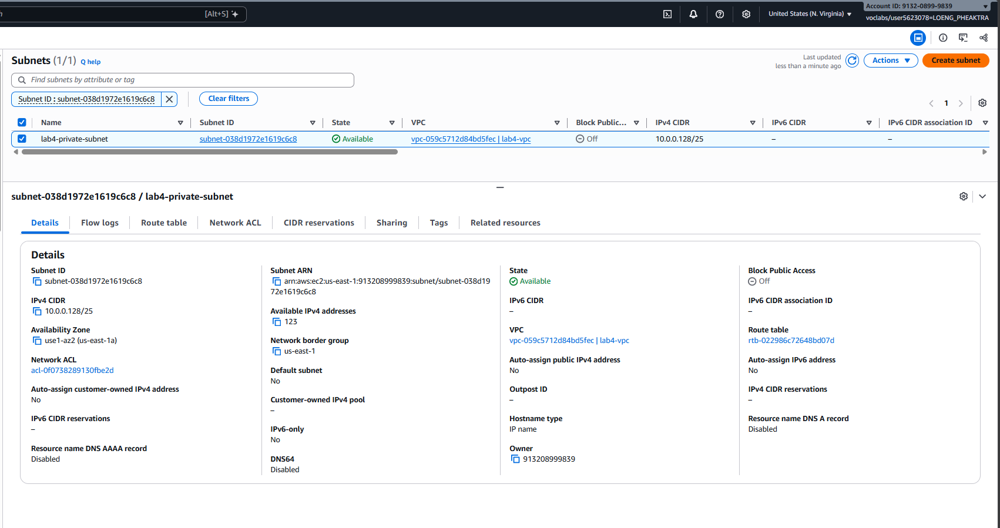

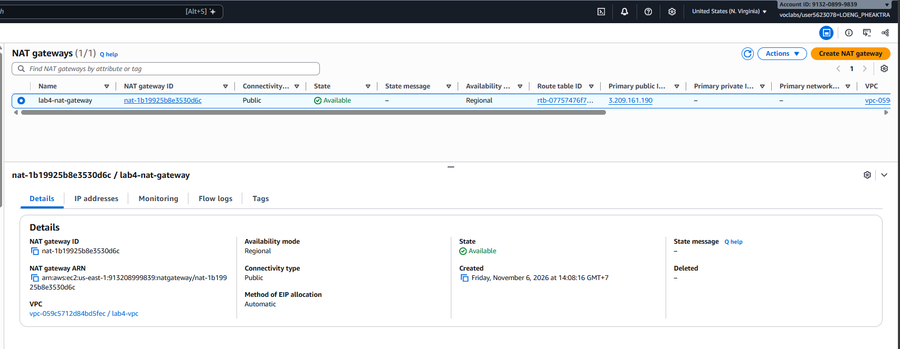

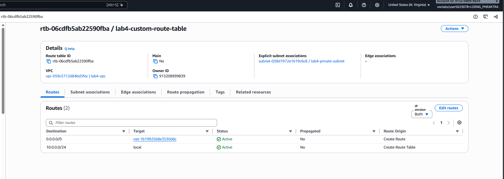

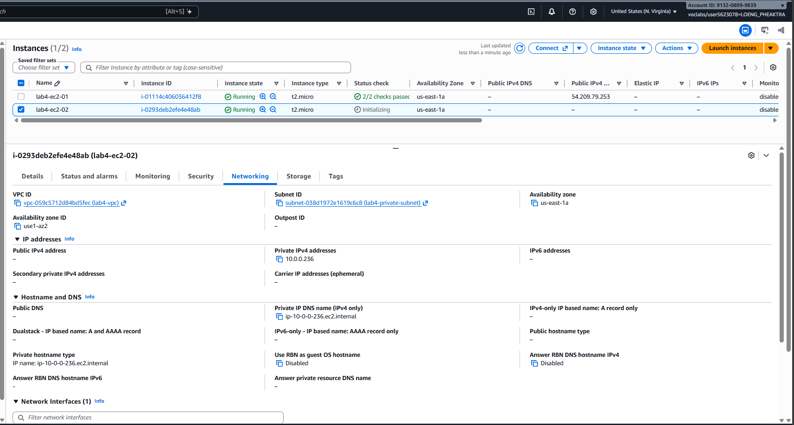

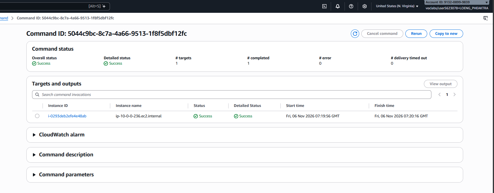

---

## Questions

1. The VPC is `10.0.0.0/24` and the subnets are `10.0.0.0/25` and `10.0.0.128/25`. How many IP addresses does each block contain, and why do the two subnets not overlap?
2. Both subnets are in the same VPC. What exactly makes `lab4-public-subnet` public and `lab4-private-subnet` private?
3. Why is the NAT gateway placed in the **public** subnet and not in the private one?
4. `lab4-ec2-02` has no public IP address. Can someone on the internet open a connection to it? Can it download updates? Explain both answers.
5. You tested internet access with Systems Manager instead of SSH. Why did the instances need `LabInstanceProfile` for this?

## Answer

1. Each subnet contains 128 IP addresses. They do not overlap because the first covers 10.0.0.0–10.0.0.127 and the second covers 10.0.0.128–10.0.0.255.

2. The public subnet has a route to the Internet Gateway (IGW). The private subnet does not have a direct route to the IGW.

3. The NAT Gateway is placed in the public subnet because it needs a public IP and access to the Internet Gateway to provide internet access to private instances.

4. Cannot receive direct internet connections because it has no public IP. Can download updates through the NAT Gateway, which allows outbound internet access.

5. LabInstanceProfile provides the IAM permissions that allow EC2 instances to communicate with AWS Systems Manager without needing SSH access.

## Problems and how I solved them (optional)

## AI note (optional)

One suggestion an AI tool gave you and how you checked it.

## Clean up

- [x] Instances terminated.
- [x] NAT gateway deleted and its Elastic IP released.
- [x] Internet gateway detached and deleted.
- [x] `lab4-vpc` deleted.
